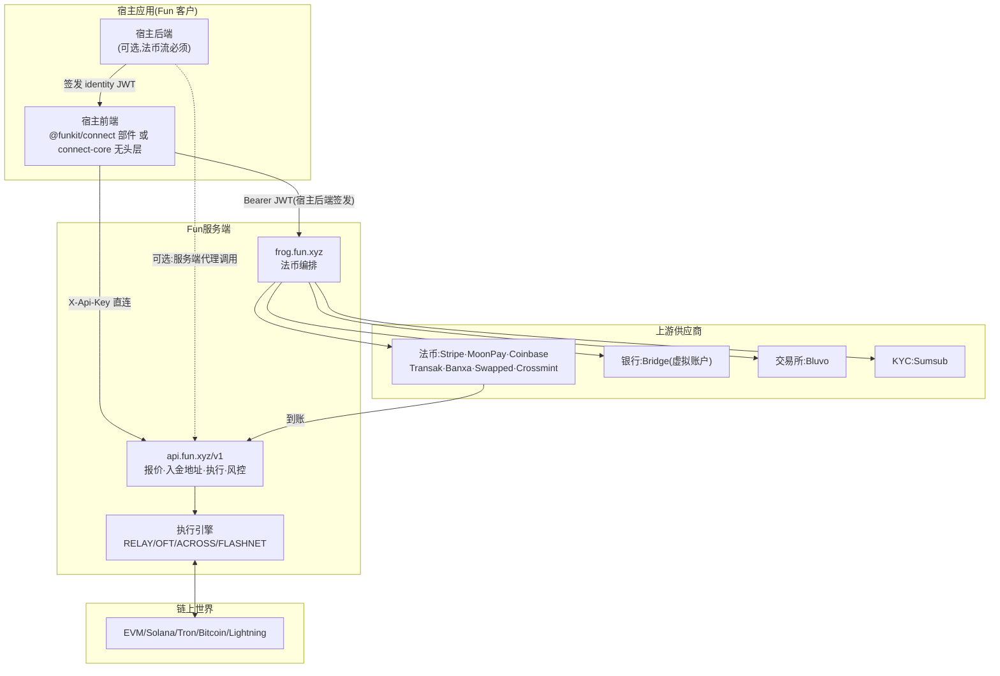
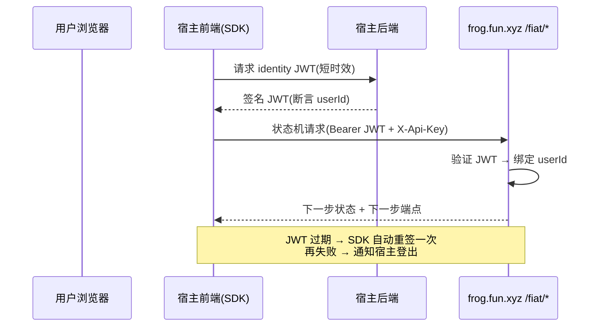
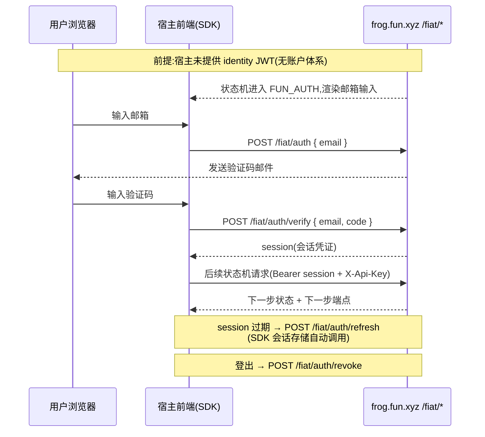
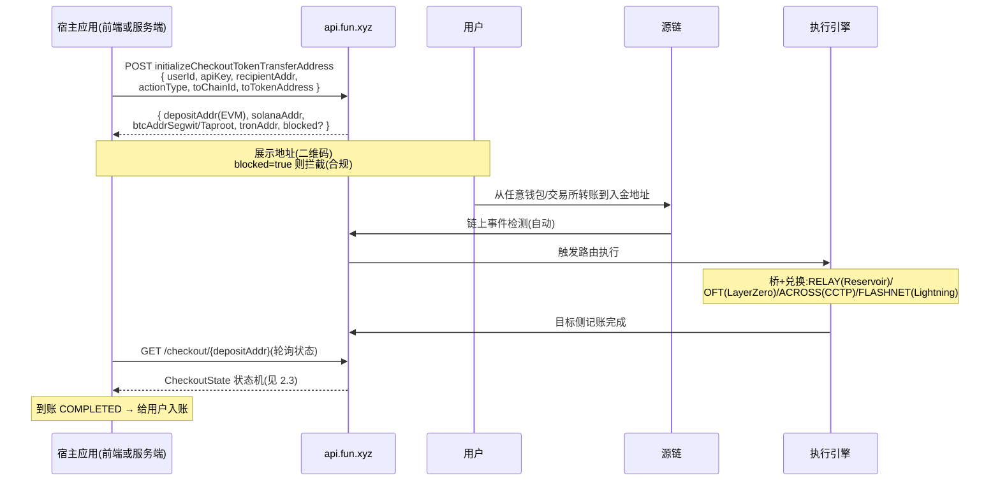
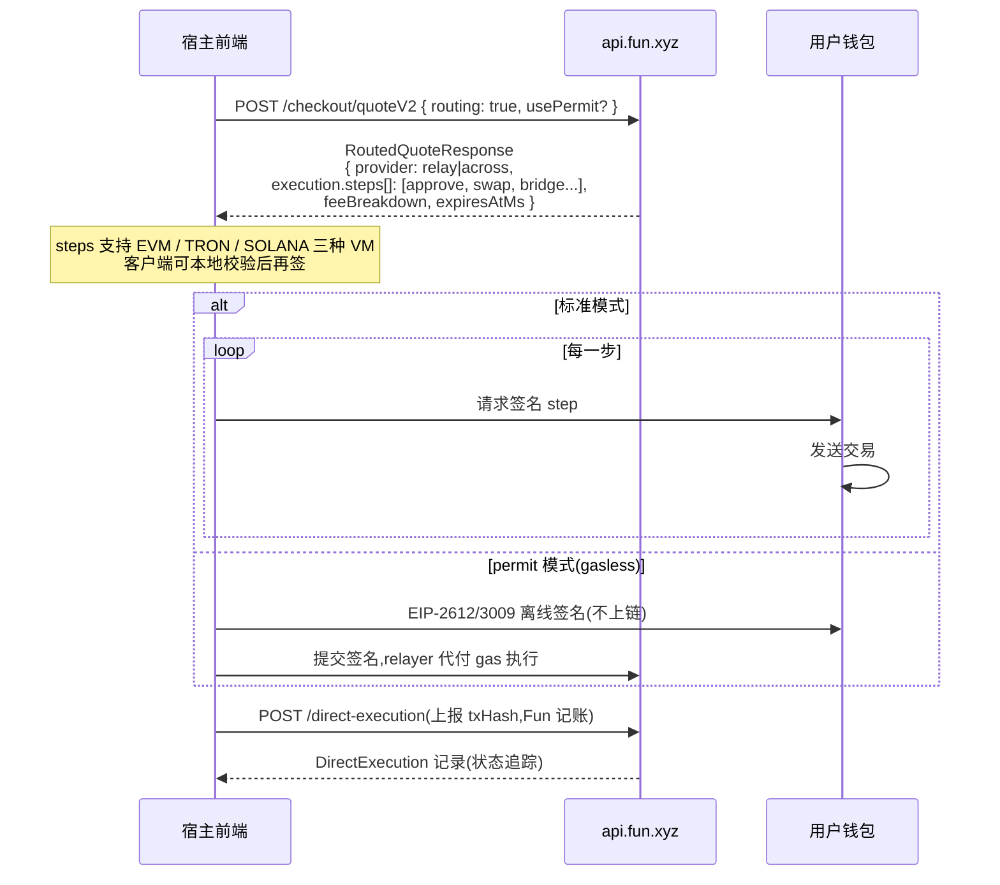
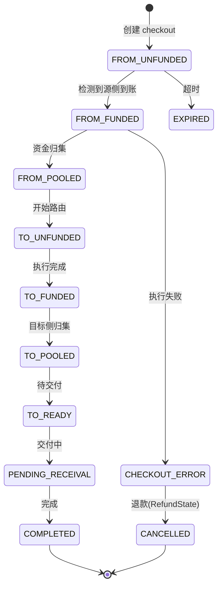
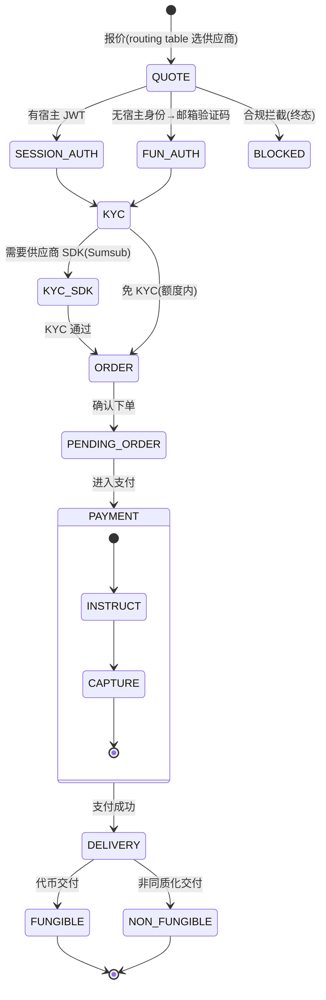
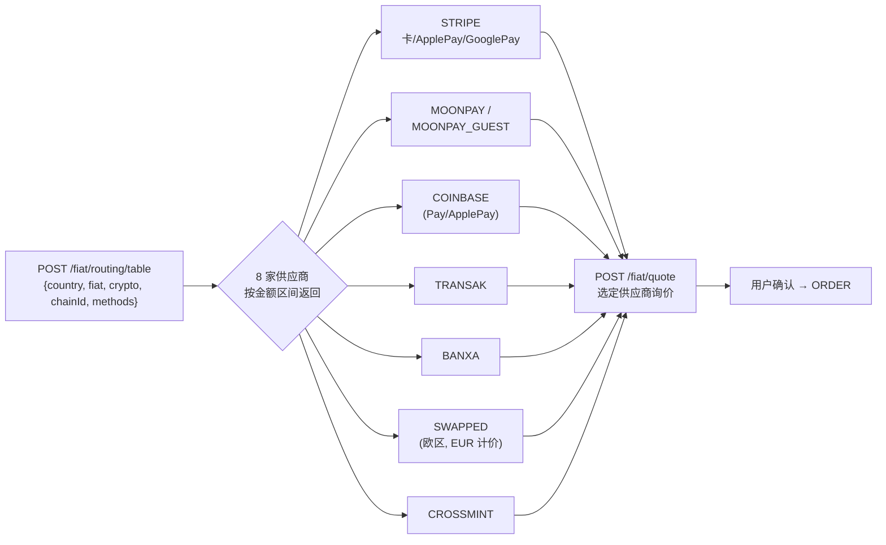
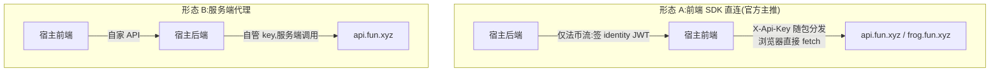

_# Fun (fun.xyz) 出入金业务流程与接入架构

> 调研日期:2026-11-02
> 依据:`@funkit/connect-core@13.0.0`(无头编排层)、`@fun-xyz/fiat-contract@0.49.0`(法币流程契约,fun-backend 同源)、`@funkit/api-base@10.0.0`、`@funkit/core@2.3.68` 还原源码;及 Fun 客户线上前端的运行时实证。
> 源码位置:`research/fun-sdk-source/`(共 209 个 TS 文件)
> 姊妹篇:`fun-xyz-调研报告.md`(公司/合规/竞争)、`fun-支付机制源码级研究.md`(机制细节)

---

## 0. 一图总览



**两条流、两种身份要求:**

| 流程 | 用户登录 | 谁调用 Fun | KYC |
|---|---|---|---|
| **数币→数币**(模式 A:UDA 入金地址) | ❌ 不需要 | 前端或服务端均可 | ❌ 不需要 |
| **数币→数币**(模式 B:客户端执行) | 需要用户钱包签名(非登录) | 前端 | ❌ 不需要 |
| **法币→数币** | ✅ 必须(宿主 JWT 或 Fun 邮箱登录) | 前端直连 + 宿主后端签 JWT | ✅ Sumsub(Fun 托管) |

---

## 1. 鉴权模型:两层分离

### 1.1 集成级:API Key(两条流都需要)

> 通俗理解:这把 key 是**"商户牌",不是"身份证"**——只告诉 Fun"是哪家集成方的应用在调用"(归属计费、费率、限流用),不代表任何终端用户。类比 Stripe 的 publishable key(`pk_live_xxx`)。数币流每个请求只带它;法币流在此基础上再加用户身份(Bearer JWT)。key 标识"谁家的应用",JWT 标识"哪个用户"。

- 传输方式:`X-Api-Key` 请求头(`api-base/src/utils/request.ts`,传输层独占该头,调用方不可覆盖)
- **每客户一把,且随前端 SDK 公开分发**:`customers.ts` 中硬编码了约 50 个客户的 key(Polymarket、Ostium、Monkey Tilt、Lighter×2、Monad、Fanatics、Whop……)
- 设计含义:**Fun 把集成 key 视同公开信息**,防护靠后端风控/限额,不靠 key 保密。集成方若要求更高,可服务端代理自管 key(见 §6)

### 1.2 用户级:仅法币流(`/fiat/*`)需要

`/fiat/*` 全部请求携带 Bearer 凭证,两种来源(`connect-core/src/domains/fiat/identityAssertion.ts`、`funAuth.ts`):

| 模式 | 机制 | 适用 |
|---|---|---|
| **宿主自带身份(首选)** | 宿主后端签发**短时效 JWT**(identity assertion),SDK 自动缓存、临期刷新、认证失败重签一次后弃用 | 宿主已有账户体系 |
| **Fun 邮箱登录(兜底)** | `POST /fiat/auth`(邮箱+验证码)→ `POST /fiat/auth/verify` → session,配套 refresh / revoke | 宿主无账户体系 |

> **JWT 验证不是"共用密钥"**:接入时宿主把**公钥**登记给 Fun;运行时宿主用**私钥**签 JWT(私钥永远不出宿主后端),Fun 只用公钥**验签**。公钥只能验真、不能伪造,所以 Fun 冒充不了宿主——与 Apple Sign In / OIDC 的 token 验证同一模式。(源码注释明确验证发生在 Fun 后端;具体登记形式——静态公钥或 JWKS 轮换——在 fun-backend 私有仓库,公开层面不可见。)

> **邮箱登录是条件分支,不是必经步骤**:法币状态机入口处分叉——宿主提供了 JWT → `SESSION_AUTH`(验签通过即继续);宿主未提供 → `FUN_AUTH`(邮箱+验证码,见 §3.1 状态图)。源码注释:"Fun's own email login, for a customer whose host mints no identity assertion"。走宿主 JWT 路径的集成方的用户**永远看不到** Fun 的邮箱登录界面。

**路径一:宿主 JWT(首选)**



**路径二:Fun 邮箱登录(兜底,仅当宿主未提供身份)**



**数币流不需要任何用户身份**:UDA 入金只需 `userId`(可以是宿主自定义标识)+ `recipientAddr`。

---

## 2. 数币→数币:两种执行模式

### 2.1 模式 A:UDA 入金地址(推荐,零登录零钱包)

核心:为用户铸造一个**多链通吃的入金地址**,用户从任何地方转任意币,Fun 后端检测到账后自动路由兑换到目标资产、记入收款方。



**要点:**
- **无需登录、无需钱包连接、无需 KYC**——`recipientAddr` 甚至可以是合约地址或纯数字账户号(account index `"1234"` 这类宿主账户号在 Fun 类型系统 `FunAddress` 中是合法值)
- 一次性返回全 VM 地址:EVM / Solana / Bitcoin(Segwit+Taproot)/ Tron
- 首笔入金即可为新用户开户("入金自动开户"即此)
- 可选预报价:`POST /checkout/quoteV2` 展示费用明细(FeeBreakdownV2:gas/fillCost/swapImpact/appFee/minReceived)

### 2.2 模式 B:客户端执行(需要用户钱包)

报价直接返回**完整可执行的动作序列**,用户钱包逐步签名执行,Fun 只做记账(`CONTRACT_CALL` 类型)。

**逐步拆解:**

```
① 前端调 POST /checkout/quoteV2,带 routing: true
② Fun 返回 RoutedQuoteResponse:
   · provider: 选中的执行供应商(relay | across)
   · execution.steps[]: 完整有序的链上动作序列,例如
       第1步 { vm:"EVM", to:USDC合约, data: approve… }        ← 授权
       第2步 { vm:"EVM", to:跨链桥,   data: deposit…, value:0 } ← 桥入金
       …(兑换/桥/目标动作全部列好,calldata 就是最终执行内容)
   · metadata.feeBreakdown + expiresAtMs
③ 用户连接的钱包(MetaMask 等)逐步弹窗签名、逐笔发链上交易
   —— 每一步用户都能在钱包里看到,客户端也可先本地校验再签
④ 全部执行完,前端把最终 txHash 报给 POST /direct-execution
   类型 = CONTRACT_CALL:Fun 只做记账与状态追踪,不参与路由
   (源码注明 "No funkit-side routing or relay involvement")
```

**permit 变体(gasless)**:第 ③ 步不发 approve 交易,改为对 EIP-2612(permit)/EIP-3009(transferWithAuthorization)消息做**离线签名**,交给中继者代提交——用户全程不付 gas。这就是 gasless 入金变体。

一句话:**模式 B 里 Fun 只当"报价引擎 + 记账员",资金的每一步链上移动都从用户自己的钱包发出。**



### 2.3 订单状态机(两种模式共用)



> 源侧 `FROM_*` 与目标侧 `TO_*` 分离推进,精确表达跨链两阶段承诺;退款走独立的 `RefundState` 状态机(INITIATED → WAITING_FOR_FULFILLMENT → REFUNDED / PROCEEDED)。
> 注意:老版 `POST /checkout`(入金即执行预签名 UserOp)将于 **2026-12-21 下线**,由上述两条新路径替代。

### 2.4 两种模式对比与选型

| 维度 | 模式 A:UDA 入金地址 | 模式 B:客户端执行 |
|---|---|---|
| **谁执行链上动作** | Fun 后端(检测到账后代为路由执行) | 用户自己的钱包逐笔签名执行 |
| **用户需要什么** | 什么都不用连——从任何地方转账都行(交易所提币、冷钱包、他人代付) | 浏览器里必须连接钱包 |
| **资金路径** | 先进 Fun 的入金地址,再由 Fun 路由到目标 | **不经过 Fun 的地址**,用户钱包直达各合约 |
| **gas 谁付** | Fun(含在报价费用里) | 用户付(permit 变体除外——中继者/paymaster 代付) |
| **执行节奏** | 异步:转账后等链上检测(通常几分钟,状态机轮询) | 同步:用户签一步走一步,当场确认 |
| **可验证性** | 黑盒:信任 Fun 兑现(`minReceived` 保底兜住) | 白盒:`execution.steps[]` 即最终 calldata,客户端可本地校验后再签 |
| **失败处理** | Fun 的退款状态机(INITIATED→REFUNDED…) | 钱包/区块浏览器直接看到失败,用户自行重试 |
| **Fun 的角色** | 全托管式:检测、路由、清结算、退款 | 仅报价 + 记账(CONTRACT_CALL) |
| **典型场景** | 纯入金、无钱包用户、交易所直提、移动端扫码 | DApp 内已连钱包、兑换+入金一步完成、对托管敏感的用户 |

**选型:**
- 产品只有"充值"场景、用户来源杂(交易所/转账/扫码)→ **模式 A**,零门槛转化率最高
- 用户已在 DApp 里连着钱包、本来就要签名 → **模式 B** 顺理成章,顺路打包"兑换+桥+入金";想再降门槛用 permit 变体(零 gas)
- **两者不互斥**:同一宿主可同时开启——Funkit 部件走 A,自研 gasless 入金走 B 的 permit 变体

> 一句话:**模式 A 信任换便捷**(资金先进 Fun 地址,换来"从哪都能充");**模式 B 便捷换自主**(资金不出自己钱包,但要连钱包、非 permit 时自己付 gas)。

---

## 3. 法币→数币:服务端驱动的状态机

**所有状态流转逻辑都在 Fun 服务端**(`frog.fun.xyz`),前端只是状态机渲染器——每步响应携带下一步要调的端点字符串,客户端零硬编码,上新支付渠道不需要前端发版。

### 3.1 完整状态机(`@fun-xyz/fiat-contract` 契约原文)



**PAYMENT 阶段的两种形态:**

| 阶段 | 形态 | 说明 |
|---|---|---|
| INSTRUCT(指令) | `BANK_FIELDS` | 银行转账表单(收款户名/账号/金额) |
| | `DEEPLINK` | 跳转本地 App(Venmo / Cash App) |
| | `QR_IMAGE` | 扫码支付(如巴西 PIX) |
| | `REFERENCE` | 汇款参考号(欧洲 SEPA 引用) |
| CAPTURE(捕获) | Stripe | clientSecret + 3DS 循环(每次挑战共用同一幂等回调 id) |
| | MoonPay | SDK 步进式捕获(含 KYC 步骤) |
| | Coinbase | OTP → 确认 → Pay |

### 3.2 供应商路由与询价



**支付方式枚举**(`PaymentMethod`,前端部件呈现):`card`(Meld 卡)、`venmo`、`apple_pay`、`google_pay`、`revolut_pay`、`sepa` / `sepa_instant`、`virtual_bank`(Bridge 虚拟银行账户)、`swapped_card`、`cash_app_lightning` / `bitcoin_lightning`、`brokerage`(Bluvo 交易所直划)、`token_transfer`、`balance`。

### 3.3 关键工程约束(源码实证)

1. **写操作强制幂等键**:fiat 写端点的 `idempotencyKey` 在 TypeScript 类型上必填(union 分支),从编译期消灭重试双扣;Stripe 回调 id 还作为其幂等键,3DS 每次挑战共用一个 id
2. **限流语义化**:429 携带 `retryAfterSeconds`,>1s 才自动重试
3. **合规留痕内建**:条款接受(terms acceptance)、数据分享同意(sharing consent)、地区策略(region policy)都是状态机的一等公民
4. **KYC-of-record 是 Fun 自己的租户**:`KYCProvider = 'SUMSUB'`,注释明确"身份面永远不由 onramp 供应商铸造"

---

## 4. 出金方向(供参考,非本次重点)

- **数币→法币(off-ramp)**:`CRYPTO_TO_FIAT` rail,Swapped 出金配置(`SwappedCryptoToFiatRailConfig`)+ `cryptoWithdrawal` 域,法币同样走 `/fiat/*` 身份与状态机
- **数币出金到链/交易所**:fast withdrawal 类流程,`swappedWithdrawal` 域
- 订单追踪复用 `direct-execution` 记录(含退款 `RefundState`)

---

## 5. 接入架构:前端直连 vs 服务端到服务端

### 5.1 两种形态对比



| 维度 | 形态 A:前端直连 | 形态 B:服务端代理 |
|---|---|---|
| 官方支持 | ✅ 主形态(SDK 即为此设计) | ✅ 可行(api-base 同构,Node/浏览器同一份代码) |
| API key | 随前端分发,视同公开 | 服务端保管,可保密 |
| 法币身份 | 宿主后端签 JWT(仍需后端) | 代理层注入身份 |
| 时延/体验 | 最短路径,部件开箱即用 | 多一跳,可控缓存与风控 |
| 现成案例 | Polymarket 等前端直连 | 宿主可自建白标代理层(代理 Fun API,要求第三方仅服务端调用) |

### 5.2 SDK 分工

| 包 | 角色 |
|---|---|
| `@funkit/connect` | React 收银台部件(完整 UI,接入最快) |
| `@funkit/connect-core` | **无头编排层**(web/RN 共用,自研 UI 用) |
| `@funkit/api-base` | API 客户端(同构 fetch,可纯服务端) |
| `@funkit/core` | FunWallet 智能钱包(ERC-4337)+ gas 赞助 |
| `@funkit/chains` | 链元数据(含非 EVM 链的十进制链 ID) |
| `@fun-xyz/fiat-contract` | 法币状态机契约(纯类型,前后端同源) |

---

## 6. 接入决策表

| 你的场景 | 推荐方案 | 登录要求 | 工作量 |
|---|---|---|---|
| 只做数币入金,产品无账户体系 | 模式 A(UDA),前端或服务端直调 | 无 | 最小:一次 API 调用 + 状态轮询 |
| 数币入金 + 用户已连钱包 | 模式 B 或 A 皆可 | 钱包签名(模式 B) | 小 |
| 要做法币入金 | `@funkit/connect` 部件 + 宿主后端签 JWT | 必须(宿主 JWT 或 Fun 邮箱) | 中:身份打通 + KYC 旅程 |
| 法币 + 自研 UI | `@funkit/connect-core` 无头层 | 同上 | 中大:自渲染状态机 |
| 强合规/大额 | 服务端代理形态 B | 同上 | 大 |

---

## 附录 A:关键 API 速查

**api.fun.xyz/v1(X-Api-Key)**

| 端点 | 用途 |
|---|---|
| `POST /checkout/quoteV2` | 报价(EXACT_IN/OUT、Lightning、routed) |
| `initializeCheckoutTokenTransferAddress` | 铸造 UDA 全 VM 入金地址 |
| `POST /direct-execution` | 执行记录上报/创建 |
| `GET /checkout/{depositAddr}` / `GET /checkout/userId/{id}` | 订单追踪 |
| `POST /fops` | 可用支付方式(按国家/用户) |
| `POST /checkout/risk-assessment` | 地址风控(Chainalysis 同形) |
| `GET /assets/supported` 等 | 资产/价格 |

**frog.fun.xyz(法币,Bearer JWT + X-Api-Key)**

| 端点 | 用途 |
|---|---|
| `POST /fiat/routing/table` | 供应商限额矩阵 |
| `POST /fiat/quote` | 法币询价 |
| `POST /fiat/auth` / `verify` / `refresh` | Fun 邮箱登录(兜底) |
| `POST /fiat/next` | 状态机推进(端点由上步下发) |
| `/api/bluvo/*`、`/api/bridge/*`、`/api/meld/*`、`/api/swapped/*` | 供应商子域 |

## 附录 B:源码文件索引(本篇新增)

| 文件 | 内容 |
|---|---|
| `connect-core/src/domains/fiat/identityAssertion.ts` | 宿主 JWT 身份断言(缓存/刷新/拒绝) |
| `connect-core/src/domains/fiat/funAuth.ts` | Fun 邮箱登录端点 |
| `connect-core/src/domains/fiat/authedTransport.ts` | 带身份的传输层(失败重签一次) |
| `connect-core/src/domains/fiat/routingTable.ts` | 供应商路由表 |
| `connect-core/src/domains/fiat/providers/{moonpay,coinbase}/` | 供应商 checkout 步进 |
| `connect-core/src/domains/fiat/stripeCheckout.ts` | Stripe 支付(3DS 幂等) |
| `connect-core/src/domains/checkoutTransfer.ts` | UDA 参数构造(数币入金核心) |
| `connect-core/src/domains/paymentMethods.ts` | 支付方式枚举 |
| `fiat-contract/dist/types.d.ts` | 法币状态机契约(FlowState/OrderStatus/KYC) |
| `api-base/src/utils/request.ts` | X-Api-Key 传输层 |
| `api-base/src/consts/customers.ts` | ⚠️ 全部客户 key 硬编码(安全观察) |_
