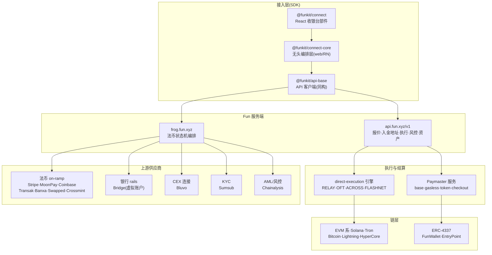
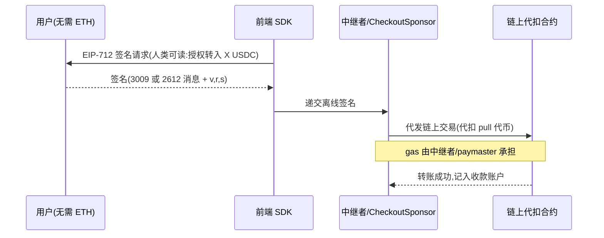

# Fun (fun.xyz) 功能与接口完整文档

> 定位:**工程接入参考手册**——架构图、功能清单、全部 API 端点、请求/响应字段、枚举、错误码。
> 来源:`@funkit/api-base@10.0.0`、`@funkit/core@2.3.68`、`@funkit/chains@2.6.1`、`@funkit/utils@5.1.1`、`@funkit/connect-core@13.0.0`、`@fun-xyz/fiat-contract@0.49.0` 还原源码(位于 `research/fun-sdk-source/`)。
> 姊妹篇:《fun-出入金业务流程与接入架构》(流程视角)、《fun-支付机制源码级研究》(机制视角)、《fun-xyz-调研报告》(公司视角)。
> 版本日期:2026-11-02。接口可能随后端演进,以实际版本为准。

---

## 1. 系统架构

### 1.1 分层架构图



### 1.2 域名与服务清单

| 域名 | 角色 | 鉴权 |
|---|---|---|
| `api.fun.xyz/v1` | 核心网关:报价、checkout、入金地址、执行、风控、资产 | `X-Api-Key`(法币 `/fiat/*` 另加 Bearer) |
| `frog.fun.xyz` | 法币编排 + 供应商代理(meld/bluvo/bridge/swapped/xstocks/geo/rates) | 同上 |
| `data-api.fun.xyz` | 埋点分析(PostHog 协议自托管) | client key |
| `sdk-cdn.fun.xyz` | 静态资源 CDN(代币/链图标) | 无 |
| `app.fun.xyz` | Fun 自营前端 | — |

### 1.3 SDK 包矩阵

| 包 | 用途 | 可用环境 |
|---|---|---|
| `@funkit/connect` | 收银台部件(完整 UI) | React/Web |
| `@funkit/connect-core` | 无头编排层(fiat 状态机、报价、入金选择) | Web + React Native |
| `@funkit/api-base` | 全部 API 客户端 + 类型 | 同构(Node 可用,支持纯服务端接入) |
| `@funkit/core` | FunWallet(ERC-4337)+ 赞助 + 操作 | 同构 |
| `@funkit/chains` | 链元数据与链 ID 常量 | 同构 |
| `@funkit/utils` | 工具 + 错误码 | 同构 |
| `@fun-xyz/fiat-contract` | 法币契约(纯类型 + zod schema,前后端同源) | 同构、零依赖 |

---

## 2. 功能全景

| 功能域 | 能力 | 鉴权要求 | 关键端点/模块 |
|---|---|---|---|
| **数币入金** | UDA 多链入金地址(一址全 VM) | 仅 API key | `initializeCheckoutTokenTransferAddress` |
| | 闪电网络入金(bolt11 发票) | 仅 API key | quoteV2(fromChainId=29780) |
| | CEX 直划(Bluvo) | API key | `/api/bluvo/*` |
| | gasless 入金(permit 签名代扣) | API key + 钱包签名 | quoteV2 `usePermit` |
| **法币入金** | 8 供应商 × 本地支付方式路由 | API key + 用户身份 | `/fiat/*` 状态机 |
| | KYC(Sumsub,30+ 标准字段) | 同上 | `/fiat/kyc/*` |
| **报价** | EXACT_INPUT / EXACT_OUTPUT;费用全拆解 | 仅 API key | `quoteV2` |
| **执行路由** | RELAY/OFT/ACROSS/FLASHNET/CONTRACT_CALL | 仅 API key | `/direct-execution` |
| **出金** | 加密→法币(off-ramp);快速出金 | API key + 用户身份 | `/fiat/*`、`swappedWithdrawal` |
| **智能钱包** | FunWallet 创建/操作/会话密钥/Passkey | 钱包侧 | `@funkit/core` |
| **gas 赞助** | 四种 Paymaster | API key | `fw-paymaster` |
| **风控合规** | 地址风险评分、地区拦截、KYC/AML | 仅 API key | `/checkout/risk-assessment` |
| **资产数据** | 支持资产/价格/钱包持仓/Lido 提款 | 仅 API key | `/assets/*` |

---

## 3. 鉴权(速览)

| 层 | 凭证 | 范围 |
|---|---|---|
| 集成级 | `X-Api-Key` 头 | 全部端点;"商户牌"标识集成方 |
| 用户级 | `Authorization: Bearer <JWT 或 session>` | 仅 `/fiat/*`;标识终端用户 |

法币用户身份两种模式(**Mode 1 / Mode 2**):
- **Mode 1(宿主 JWT)**:宿主后端私钥签 JWT,Fun 用公钥验签;收款人从 JWT 断言取
- **Mode 2(FUN_OTP)**:Fun 邮箱验证码登录;客户端每次 `/fiat/next` 请求带 `depositAddress` 作为收款人

详见《fun-出入金业务流程与接入架构》§1。

---

## 4. 接口文档:api.fun.xyz/v1

### 4.1 报价:`POST /checkout/quoteV2`

**请求 `CheckoutQuoteRequestV2`:**

| 字段 | 类型 | 必填 | 说明 |
|---|---|---|---|
| `fromChainId` | string | ✅ | 源链 ID(非 EVM 链用十进制大数,见 §11) |
| `fromTokenAddress` | Address \| SolanaAddress | ✅ | 源代币地址 |
| `toChainId` | string | ✅ | 目标链 ID |
| `toTokenAddress` | Address | ✅ | 目标代币地址 |
| `userAddress` | Address \| SolanaAddress | ✅ | 用户地址 |
| `recipientAddress` | FunAddress | ❌ | 收款方(可缺省) |
| `fromAmountBaseUnit` | bigint | 二选一 | EXACT_INPUT |
| `toAmountBaseUnit` | bigint | 二选一 | EXACT_OUTPUT |
| `usePermit` | boolean | ❌ | `true`=permit 签名;`false`=approve;缺省后端决定 |
| `routing` | boolean | ❌ | `true` 返回 provider-aware 路由报价 |
| `actionParams` | ApiFunkitCheckoutActionParams[] | ❌ | 附带链上动作(随路径一起报价) |
| `bridgeOverride` | `'across'` \| `'relay'` | ❌ | 强制桥选路 |

**响应(普通 `CheckoutQuoteResponseV2`)**——在基础报价上叠加:

| 字段 | 说明 |
|---|---|
| `metadata.feeBreakdown: FeeBreakdownV2` | 费用拆解(§7.1) |

**响应(`routing:true` → `RoutedQuoteResponse`)**:

| 字段 | 类型 | 说明 |
|---|---|---|
| `provider` | `'relay'` \| `'across'` | 选中的执行供应商 |
| `tradeType` | `EXACT_INPUT` \| `EXACT_OUTPUT` \| `EXPECTED_OUTPUT` | 交易类型 |
| `expiresAtMs` | number | 报价过期时刻 |
| `execution.steps[]` | CheckoutExecutionStep[] | **完整有序钱包动作(含 approve)**,可本地验证 |
| `metadata.feeBreakdown` | FeeBreakdownV2 | 费用 |
| `metadata.oftEnabled` | boolean? | 是否可走 OFT |
| `metadata.relayQuote` | object? | Relay 原始报价(steps/details) |

```ts
type CheckoutExecutionStep =
  | { vm: 'EVM';    to: Address;     data: Hex; value: string }
  | { vm: 'TRON';   to: TronAddress; data: Hex; value: string }
  | { vm: 'SOLANA'; to: SolanaAddress; serializedTx: string }
```

**Lightning 变体**(`fromChainId=29780`,`fromAmountSats` 计额)→ `LightningQuoteResponse`:

| 字段 | 说明 |
|---|---|
| `invoice.bolt11` / `invoice.amountSats` / `invoice.expiresAtMs` | 闪电发票 |
| `estimate.amountOutBaseUnit` / `estTotalUsd` / `estFeesUsd` | 估算 |
| `flashnet.quoteId` / `flashnet.orderId` | Flashnet rail 单号 |

### 4.2 创建 Checkout(旧):`POST /checkout`

> ⚠️ **2026-12-21 下线**。新接入用 4.3(入金地址)或 4.5(direct-execution)。

| 请求字段 | 类型 | 说明 |
|---|---|---|
| `userOp` | UserOperation | 已签名的 ERC-4337 操作(入金即执行) |
| `quoteId` | string | 报价 ID |
| `sourceOfFund` | string | 资金来源(card/bank/exchange/crypto…) |
| `salt` | Hex | 随机盐(客户端生成) |
| `checkoutId` | string | 客户端 UUID(贯穿会话与埋点) |
| `clientMetadata` | object | 透传元数据 |

响应:`{ depositAddr: Address }`

### 4.3 铸造入金地址:`initializeCheckoutTokenTransferAddress`

**请求 `CheckoutInitTokenTransferAddressParams`:**

| 字段 | 类型 | 必填 | 说明 |
|---|---|---|---|
| `userId` | string | ✅ | 用户标识(宿主自定义或钱包地址) |
| `recipientAddr` | string | ✅ | 资金落点(EVM/Solana/BTC/Tron/账户号均可) |
| `toChainId` | string | ✅ | 目标链 |
| `toTokenAddress` | Address | ✅ | 目标代币(入金自动兑换至此) |
| `actionType` | string | ❌ | 客户定制路由动作(如 `LIGHTER_PERPS`) |
| `sourceOfFund` | string | ❌ | 资金来源标记 |
| `checkoutId` | string | ❌ | 会话 UUID |
| `clientMetadata` | object | ✅ | 透传元数据 |

**响应 `CheckoutInitTokenTransferResponse`:**

| 字段 | 类型 | 说明 |
|---|---|---|
| `depositAddr` | Address | EVM 入金地址 |
| `solanaAddr` | SolanaAddress | Solana 入金地址 |
| `btcAddrSegwit` / `btcAddrTaproot` / `btcDepositAddr` | BitcoinAddress | BTC 三格式 |
| `tronAddr` | TronAddress | Tron 入金地址 |
| `blocked` | boolean? | **合规拦截标记,必须检查** |

### 4.4 查询与取消

| 端点 | 说明 |
|---|---|
| `GET /checkout/{depositAddress}` | 按入金地址查单 |
| `GET /checkout/recipient/{recipientAddress}` | 按收款方查单 |
| `GET /checkout/userId/{userId}?limit=N` | 按用户查历史(`CheckoutHistoryItem[]`) |
| `POST /checkout/update/{depositAddress}` | 更新状态(body `{state:'CANCELLED'}` 取消) |

**`CheckoutHistoryItem` 字段:**

| 字段 | 说明 |
|---|---|
| `createdTimeMs` / `lastUpdatedTimeMs` / `expirationTimestampSeconds` | 时间戳组 |
| `depositAddr` / `currentDepositAddr` | 入金地址 |
| `recipientAddr` / `funWalletAddr` | 落点与钱包 |
| `fromChainId` / `fromTokenAddress` / `fromAmountBaseUnit` | 源侧三元组 |
| `toChainId` / `toTokenAddress` / `toAmountBaseUnit` | 目标侧三元组 |
| `state` | CheckoutState(§8.1) |
| `refundState?` | 退款状态(§8.2) |
| `sourceOfFund` / `clientMetadata` / `salt` / `version` | 上下文 |
| `userOp?` | 关联的 ERC-4337 操作 |
| `stateTimestampMs?` | 各状态发生时刻映射 |

### 4.5 执行引擎:`/direct-execution`

| 端点 | 说明 |
|---|---|
| `POST /direct-execution` | 创建执行记录(客户端执行后上报,或 relay 执行登记) |
| `GET /direct-execution/{txHash}` | 按交易哈希查(AA 交易为 userOpHash) |
| `GET /direct-execution/userId/{userId}/deposit-events` | 按用户查入金事件 |

**`DirectExecution` 记录核心字段:**

| 字段 | 说明 |
|---|---|
| `txHash` / `onChainTxHash` | userOpHash / 链上实际哈希 |
| `customerId` / `userId` / `checkoutId` | 归属 |
| `recipientAddr` | 收款方(FunAddress) |
| `type` | DirectExecutionType(§8.3) |
| `from/to` 链、代币、金额、`estTotalUsd` | 交易要素 |
| `sourceOfFund` | 资金来源 |
| `listenerInfo` | 执行监听:Relay 状态 / LayerZero 路径(含 lzCompose)/ Lighter 执行状态 |
| `isDepositDetectionDE` | 链上事件检测合成的临时记录 |
| `isIntermediaryPhase` / `triggeringTxHash` / `toTxId` | 中间态与关联交易 |

### 4.6 可用支付方式:`POST /fops`

> fops = **Forms of Payment**。按用户与国家返回可用 rail 配置。

**请求 `GetFopsParams`:**

| 字段 | 必填 | 说明 |
|---|---|---|
| `userId` | ✅ | 用户标识 |
| `recipientAddress` | ⚠️ 弃用中 | schema 仍要求,railConfigs 存在时忽略 |
| `destinationToken` | ⚠️ 弃用中 | `{chainId, address}` |
| `railConfigs[]` | 推荐 | 类型化 rail 配置(见下) |

`railConfigs`(三选一类型 `RailConfig`):

| 类型 | 关键字段 |
|---|---|
| `FIAT_TO_CRYPTO` | `fiatCurrencyCode`、`recipientTargets[{recipientAddress, destinationToken}]`、`checkoutLimitsCriteria{defaultMinAmount(EUR), defaultMaxAmount?}`、`baseCurrencyCode/Amount`、`lockAmount/lockBaseCurrency` |
| `CRYPTO_TO_FIAT` | `sourceToken{chainId, address}` + 同上公共字段 |
| `CRYPTO_TO_CRYPTO` | `recipientTargets` + `baseCurrencyCode` |

公共字段:`userId`、`countryCode`、`thirdPartyPaymentConfigs.swapped{email, themeConfig}`。

### 4.7 风险评估:`POST /checkout/risk-assessment?address=&chainId=`

**响应 `RiskAssessmentResponse`:**

| 字段 | 说明 |
|---|---|
| `risk` | `'Severe' \| 'High' \| 'Medium' \| 'Low'` |
| `riskReason` / `cluster{name, category}` | 风险原因与地址聚类 |
| `addressType` / `addressIdentifications[]` | 地址类型与标签 |
| `exposures[]` | `{category, value, exposureType: direct\|indirect, direction}` |
| `triggers[]` | 触发的规则 `{category, percentage, message}` |
| `poolMetadata` | `{fees?, tokens[]}` |

### 4.8 资产与价格

| 端点 | 说明 |
|---|---|
| `GET /assets/supported` | 全部支持资产(含名称/logo) |
| `GET /assets/allow` | 允许清单 |
| `GET /asset/erc20/price/{chainId}/{tokenAddress}` | 单价(响应仅 `unitPrice` 有效) |
| `GET /asset/erc20/{chainId}/{symbol}` | 按符号查资产信息 |
| `GET /assets/erc20s/{walletAddress}?onlyVerifiedTokens=` | 钱包全链持仓 |
| `GET /assets/erc20s/{walletAddress}/{chainId}?onlyVerifiedTokens=` | 钱包单链持仓 |
| `GET /assets/lido-withdrawals/{walletAddress}/{chainId}` | Lido 提款记录 |

### 4.9 其他

| 端点 | 说明 |
|---|---|
| `POST /eoa` | EOA 账户创建/查询 |
| `POST /dashboard/paymasters/add-transaction` | paymaster 代付记录上报(字段:`chain, sponsorAddress, type, timestamp, transaction, txid`) |

---

## 5. 接口文档:frog.fun.xyz(法币状态机)

### 5.1 端点全景(契约 `FiatEndpoint` 有界联合,23 个 + 路由 2 个)

**入口与发现:**

| 端点 | 说明 |
|---|---|
| `GET /fiat/payment-methods` | 可用支付方式发现 |
| `POST /fiat/routing/table` | **路由表**:按国家/法币/加密币/链/方式返回各供应商金额区间(响应含 `expiresAt`,advisory) |
| `POST /fiat/quote` | 询价(可带 `routingOverrides`) |
| `POST /fiat/routing/quote` | 路由询价(过渡期,逐步被 `/fiat/next` 取代) |
| `GET /fiat/quotes/{quoteRef}` | 取报价详情 |

**身份:**

| 端点 | 说明 |
|---|---|
| `POST /fiat/auth` | 邮箱登录发起。body:`{email}` 或 `{verificationRef}`(重发) |
| `POST /fiat/auth/verify` | body:`{verificationRef, otpCode}` → VERIFIED + session |
| `POST /fiat/auth/refresh` | body:`{refreshHandle}` → 新 session(401 则重登) |
| `POST /fiat/auth/revoke` | body:`{refreshHandle}`,204 幂等 |
| `POST /fiat/session` / `POST /fiat/session/verify` | 供应商会话建立 |
| `POST /fiat/payment-session` | 预备支付会话(如 Coinbase Apple Pay) |

**KYC:**

| 端点 | 说明 |
|---|---|
| `POST /fiat/kyc/form` | 提交声明式表单(FormDescriptor) |
| `POST /fiat/kyc/capture` | SDK 采集结果上报 |
| `POST /fiat/kyc/sdk-token` | 获取 KYC SDK 令牌(Sumsub) |
| `POST /fiat/kyc/document` | 文件上传 |
| `POST /fiat/instruments` | 支付工具登记(卡 brand+last4,信用卡迭代) |

**订单:**

| 端点 | 说明 |
|---|---|
| `POST /fiat/orders` | 创建订单 |
| `GET /fiat/orders/{orderId}` | 查单 |
| `GET /fiat/orders/{orderId}/instructions` | 取支付指令 |
| `POST /fiat/orders/{orderId}/confirm-payment` | 确认支付 |
| `POST /fiat/orders/{orderId}/reference` | 提交汇款参考号 |
| `POST /fiat/orders/{orderId}/cancel` | 取消 |
| `POST /fiat/orders/{orderId}/surface-result` | 前端组件结果回传(如 Stripe 3DS 结果) |
| `GET /fiat/delivery/{deliveryId}` | 交付状态轮询 |

**供应商接管:** `POST /fiat/next`——`QUOTE` 状态带 `handoff` 后,由选中供应商在此端点驱动后续流程。body 为 `FiatNextRequest`:`{provider, action, geo, destinationAsset?, depositAddress?, ...providerFields}`。

### 5.2 统一响应:`FiatStepResponse`

每个 `/fiat/*` 响应的骨架:

| 字段 | 说明 |
|---|---|
| `state` | FlowState(见 §8.6)——语义状态,子状态是 payload 判别而非新 kind |
| `transitions[]` | 可执行动作(见 5.3);空数组≠流程结束 |
| `provider?` | 供应商(BLOCKED/FUN_AUTH 可缺省) |
| `orderId?` | 订单号 |
| `routingSessionRef?` | 路由会话标识(报价确定前) |
| `providerAuthToken?` | 供应商短时凭证(clientSecret+expiresAt,静默登录用) |
| `preparedPayment?` | 预热的支付面(Apple Pay 规则:品牌按钮与 sheet 之间不得有可见步骤) |
| `refreshLimits?: true` | 提示客户端刷新限额缓存 |

### 5.3 Transition:三种模式

`body = {…params(服务端字面量), …collected(inputs 收集), …injected(expects 注入)}`;**三源 key 冲突即契约违规,不是后写覆盖**。

| 模式 | 结构 | 说明 |
|---|---|---|
| `SUBMIT` | `{id, mode:'SUBMIT', endpoint, params?, inputs?, labelFallback?}` | 渲染输入并提交 |
| `AWAIT` | `{id, mode:'AWAIT', poll:{endpoint, intervalMs, backoffFactor?, maxIntervalMs?, giveUpAfterMs?}}` | 轮询等待 |
| `CLIENT_SURFACE` | `{id, mode:'CLIENT_SURFACE', report:{endpoint, params?, expects?, result?}}` | 拉起供应商组件,结果注入回传 |

**PollSpec 边界(契约强制):** `intervalMs` 整数 500–2³¹-1;`backoffFactor` ≥1(可为 1.5);有 backoff 必须有 `maxIntervalMs` 且 ≥ intervalMs;`giveUpAfterMs` 0–2³¹-1。

**Inputs 的 FieldSpec 八型:** `TEXT`(regex/length)、`DATE`、`COUNTRY`、`FILE`、`SELECT`(options)、`HOSTED_LINK`(url)、`FORM_VALUES`(复用已带的表单)、`TERMS_ACCEPTANCE`(documentUrl+version——版本回执使争议可追溯到用户所见文本)。

### 5.4 供应商子域接口

| 端点 | 说明 |
|---|---|
| `GET /api/geo/ip-address` | IP 地理(`FiatGeo{alpha2, region?, ip?}`) |
| `GET /api/exchange-rates` | 汇率 |
| `GET /api/swapped/supportedCountries` | Swapped 国别支持 |
| `GET /api/meld/fiat` \| `POST /api/meld/quote` \| `POST /api/meld/session`(sessionType:'BUY') \| `GET /api/meld/fiatLimit` \| `GET /api/meld/defaultFiat` | Meld on-ramp |
| `GET /api/bluvo/exchanges?status=` \| `GET /api/bluvo/balance?id=` \| `GET /api/bluvo/walletId?id=` \| `POST /api/bluvo/quote` \| `POST /api/bluvo/withdrawal` | Bluvo CEX 直连 |
| `GET\|POST /api/account`、`GET\|POST /api/bridge`、`GET /api/bridge/bank[?subAccountId=]`、`GET /api/bridge/kyclink?guid=` | Bridge 银行 rails(客户/虚拟账户/KYC 链接) |
| `GET /xstocks/assets/{...}` | 代币化股票资产 |

---

## 6. 核心数据模型

### 6.1 费用拆解 `FeeBreakdownV2`

| 字段 | 说明 |
|---|---|
| `gasUsd` | 预估 gas |
| `fillCostUsd` / `fillCostPercent` | 路径填充成本 |
| `swapImpact` / `swapImpactUsd` | 兑换价格冲击 |
| `totalImpact` / `totalImpactUsd` | 合计冲击 |
| `appFeePercent` / `appFeeUsd` / `appFeeLabel` | 集成方抽成(可自定义 label,如 "Fun fee") |
| `maxSlippage` / `minReceived` | 滑点保护 |
| `exchangeRate` | 仅兑换时有 |

### 6.2 法币报价 `Quote`

| 字段 | 说明 |
|---|---|
| `quoteRef` | 报价引用 |
| `fiat` / `crypto` | `FiatAmount{currency(ISO4217), amount(小数字符串)}` / `CryptoAmount{currency(ticker), network, amount}` |
| `rate` / `totalFee` | 汇率与总费 |
| `feeBreakdown[]` | `FeeLine{id, labelFallback, amount}`(id 为 i18n key) |
| `paymentMethod` | PaymentMethodCategory |
| `expiresAt` | BE 盖章(非供应商透传);v1 全部为估价 |
| `feeSubsidy?` | 合作方补贴的费(结算后返还;预测值) |

### 6.3 `DestinationAsset`(最终交付资产,客户端总是发送)

| VM | 结构 |
|---|---|
| `EVM` | `{vm:'EVM', chainId, asset:{kind:'FUNGIBLE', token:{type:'NATIVE'}|{type:'ERC20', address}}}` 或 `NON_FUNGIBLE{address, tokenId(十进制字符串保精度)}` |
| `SOLANA` | `{vm:'SOLANA', asset:{kind:'FUNGIBLE', token:{type:'NATIVE'}|{type:'SPL', address(base58)}}}` 或 `NON_FUNGIBLE` |

后端仅在目标资产与合作方配置资产**不一致**时追加兑换;收款人永远来自断言(Mode 1)或 `depositAddress`(Mode 2),不来自此字段。

### 6.4 会话 `FiatSession`(Fun 邮箱登录产物)

| 字段 | 说明 |
|---|---|
| `accessToken` | Bearer;后端公钥验证;寿命 ≈1h |
| `refreshHandle` | 不透明,每次 refresh 轮换;SDK 不解读 |
| `expiresAtMs` | 服务端时钟 |

### 6.5 `UserOperation`(ERC-4337,`Operation` 类承载)

标准 4337 字段 + Fun 侧元数据:`opId`、`opType`、`authType`、`groupId`、`status`、`proposer`/`proposedTime`、`executedBy`/`executedTime`、`signatures[]`、`txid`、`gasUsed`、`opFee`/`opFeeUSD`、`relatedOpIds[]`。构造时自动补 `preVerificationGas`。

### 6.6 链上签名与 API 的关系(ERC-4337 / EIP-712 / EIP-2612 / EIP-3009)

这四个标准让用户**不发链上交易、只签一个消息**就能完成授权或转账。注意:签名对象是链上资产动作、消费方是链上合约(relayer 代提交),**不走 Fun 的 HTTP 端点**——API 只是信封,唯一例外是 `POST /checkout` 的 `userOp` 字段(把已签名 UserOp 塞进请求体,资金到账后由 Fun 后端代执行)。

| 标准 | 本质 | 传统方式 | 签名方式 | Fun 里的用途 |
|---|---|---|---|---|
| **EIP-712** | 签名**格式**标准(非功能) | 钱包显示乱码哈希 | 人类可读结构化数据 | 所有离线授权签名的载体 |
| **EIP-2612 permit** | 签名即**授权额度** | approve 链上交易(花 gas) | 离线签名授权,他人代提交 | LIT 的 gasless 入金 |
| **EIP-3009 transferWithAuthorization** | 签名即**转账**(USDC/USDG 系) | transfer 链上交易 | 离线签名转账授权,relayer 代扣 | USDC/USDG 的 gasless 入金(零 gas 零 ETH) |
| **ERC-4337 UserOp** | 智能钱包**操作信封** | EOA 每笔直接发交易 | 打包为 UserOperation,经 EntryPoint 执行 | FunWallet 智能钱包 + paymaster gas 代付的底座 |

**签名结构(EIP-712 message):**

```text
EIP-3009 transferWithAuthorization:
  domain: { name: "USD Coin", version: "2", chainId, verifyingContract }   // USDG: "Global Dollar" v1
  消息:  { from, to, value, validAfter, validBefore, nonce } + v, r, s

EIP-2612 permit:
  domain: { name: "Lighter", version: "1", chainId, verifyingContract }    // LIT 场景
  消息:  { owner, spender, value, nonce, deadline } + v, r, s
```

**gasless 入金时序:**



关联位置:API 层的入口是 quoteV2 的 `usePermit` 字段(§4.1,`true`=签名授权/`false`=approve 上链);UserOp 载体见 §4.2 与 §6.5;gas 承担方见 §7.6 Paymaster。

---

## 7. 枚举总表

### 7.1 Checkout 状态机

```
进行中(源侧):FROM_UNFUNDED → FROM_FUNDED → FROM_POOLED
进行中(目标侧):TO_UNFUNDED → TO_FUNDED → TO_POOLED → TO_READY → PENDING_RECEIVAL
终态:COMPLETED | CHECKOUT_ERROR | EXPIRED | CANCELLED
退款:INITIATED → WAITING_FOR_FULFILLMENT → FULFILLED | REFUNDED | PROCEEDED | ERROR
```

### 7.2 执行类型 `DirectExecutionType`

`RELAY`(Reservoir relay-kit)| `OFT`(LayerZero)| `ACROSS`(CCTP)| `FLASHNET`(Lightning)| `CONTRACT_CALL`(SDK 自发,Fun 记账)| `EXTERNALLY_FULFILLED`(纯追踪)| `TEST_EXECUTION`

Relay 执行状态 `RelayExecutionStatus`:`delayed | failure | pending | refund | success | waiting | unknown`

### 7.3 法币订单 `OrderStatus`(单调,终态从此出)

`CREATING → AWAITING_PAYMENT → PAYMENT_VERIFYING → PROCESSING → PENDING_DELIVERY → (CRYPTO_SENT | SETTLED)`;旁路:`ON_HOLD`(单后合规/金额不符,可回 PROCESSING 或 REFUNDED)、`EXPIRED`、`CANCELLED`、`FAILED`、`REFUNDED`、`CAPTURE_ORPHANED`(捕获后未成单的孤儿,非终态安全默认)

### 7.4 供应商与支付方式

| 枚举 | 值 |
|---|---|
| `FiatProvider` | `TRANSAK \| SWAPPED \| BANXA \| MOONPAY \| MOONPAY_GUEST \| STRIPE \| COINBASE \| CROSSMINT` |
| `KYCProvider` | `SUMSUB`(Fun 自有租户,身份面永不由 onramp 铸造) |
| `PaymentMethod`(部件层) | `card(Meld)·balance·brokerage(Bluvo)·token_transfer·bitcoin_lightning·cash_app_lightning·virtual_bank(Bridge)·swapped_card·sepa·sepa_instant·venmo·apple_pay·google_pay·revolut_pay` |
| `SurfaceKind` | `URL_REDIRECT · KYC_SDK · PCI_COMPONENT · PAY_SHEET · ACH_COMPONENT · AUTH_COMPONENT` |
| `Instructions.kind` | `DEEPLINK(url+appVariants) · QR_IMAGE(url) · BANK_FIELDS(fields[]+expiresAt?) · REFERENCE(code+expiresAt)` |

### 7.5 失败与拦截

| 枚举 | 值 |
|---|---|
| `FailureCategory` | `PAYMENT_DECLINED \| KYC_REJECTED \| PROVIDER_OUTAGE \| USER_ERROR \| CANCELLED \| EXPIRED(which: QUOTE\|PAYMENT_WINDOW\|INSTRUCTIONS)` |
| `Recovery` | `REQUOTE \| RETRY_PAYMENT \| CONTACT_SUPPORT \| NONE` |
| `BlockedReason` | `REGION_UNSUPPORTED \| ASSET_UNSUPPORTED \| ALL_PROVIDERS_DECLINED \| AMOUNT_UNSERVABLE \| CLIENT_UPGRADE_REQUIRED` |
| `FunAuthErrorCode` | `INVALID_EMAIL \| BAD_CODE \| CODE_EXPIRED \| TOO_MANY_ATTEMPTS \| OTP_DISPATCH_THROTTLED` |

`FailureReason = {category, retryable, recovery, code?}`——**错误是字段不是状态**,每个可失败状态都带 `error?`。

### 7.6 Paymaster

`PaymasterType = base | gasless | token | checkout`(对应 Sponsor 类族;支持 `sponsorEVMTransaction` 与 `sponsorSVMTransaction`)

---

## 8. KYC 字段目录(`StandardKycFieldId`,声明式表单可用的规范字段)

**身份:** LEGAL_FIRST_NAME / LEGAL_MIDDLE_NAME / LEGAL_LAST_NAME / DATE_OF_BIRTH / COUNTRY_OF_BIRTH / CITY_OF_BIRTH / NATIONALITY

**联系:** EMAIL_ADDRESS / EMAIL_OWNERSHIP_VERIFICATION / PHONE_NUMBER / PHONE_OWNERSHIP_VERIFICATION

**住址:** RESIDENTIAL_ADDRESS_{LINE_1, LINE_2, CITY, REGION, POSTAL_CODE, COUNTRY}

**税务:** TAX_IDENTIFIER / US_SSN_LAST_FOUR / TAX_RESIDENCE_COUNTRY

**财富来源:** EMPLOYMENT_STATUS / OCCUPATION_INDUSTRY / OCCUPATION_TITLE / SOURCE_OF_{FUNDS, INCOME, WEALTH}_DECLARATION / PURPOSE_OF_{SERVICE, TRANSACTION} / CUSTOMER_CATEGORY

**确认项(KycAcknowledgement):** RISK_ACKNOWLEDGEMENT / COOLING_OFF_ACKNOWLEDGEMENT / TERMS_ACCEPTANCE

**问卷:** `QUESTIONNAIRE_RESPONSE:{问卷}:{题目}` 模板
**证件类型(KYC_SDK):** PASSPORT / ID_CARD / DRIVERS / RESIDENCE_PERMIT / VISA(+ 期望国家 ISO alpha-3)

---

## 9. 错误码体系

### 9.1 HTTP/SDK 层(`ErrorCode`)

常用:`MissingParameter`、`InvalidParameter`、`InvalidParameterCombination`、`UserNotFound/AlreadyExists`、`ChainNotSupported`、`UserOpFailureError`、`Unauthorized`、`AuthenticationRequired`(`/fiat/*` 缺身份)、`PaymentRequired`(HTTP 402,body 带 reason/recovery)、`RequestLimitExceeded`、`BridgeRouteNotFound`、`GasSponsorFundError`、`PrefundError` 等。429 响应体带 `retryAfterSeconds`(fiat 层 >1s 才自动重试)。

### 9.2 合约层(`errors.json`,156 条)

- `FW000–FW155`:FunWallet/FunWalletFactory/Create3Deployer 等合约错误,每条含 `info`(原因)与 `suggestion`(修复建议)
- `AA21`:EntryPoint 标准"钱包缺 gas"错误

### 9.3 法币失败模型

见 §7.5 `FailureReason`——三要素(category/retryable/recovery)+ 可选 code;三种过期(报价/支付窗口/指令)各自独立。

### 9.4 安全机制:签名与加密在哪里

**HTTP 接口层无签名、无应用层加密**——没有 HMAC/nonce/时间戳签名,请求体明文 JSON(仅 TLS 传输);自定义头只有 `X-Api-Key`(明文)、`X-Fun-Checkout-Id`、`X-Fun-Client-Capabilities`,且无人机验证/设备指纹。真正的签名在三层:

| 层 | 机制 | 签什么 | 防什么 |
|---|---|---|---|
| 用户身份(仅法币) | JWT/JWS:宿主私钥签 → Fun 公钥验 | 身份声明(userId, exp) | 伪造身份;不防重放(靠 ≈1h 短时效) |
| 链上操作 | ERC-4337 UserOp 签名、EIP-712、EIP-2612 permit / EIP-3009 authorization | 交易与授权 | 未授权的资金移动 |
| 反重放替代品 | 写操作强制 `idempotencyKey`、客户端随机 `salt` | — | 重复扣款、地址碰撞 |

含义:**接口本身不设防,防线后移**——key 视同公开(拿到的只是"冒名归属",动不了用户资金:资金去向由 `recipientAddr` 决定,法币要过身份+KYC+服务端状态机,且流程端点由服务端下发、客户端伪造不了顺序)。前端直连时把 key 当"客户端标识符",安全边界在 recipientAddr 策略/限额/KYC;要求更高就走服务端代理自管 key,在代理层自行加签名防护。

---

## 10. 工程约束速查(接入必读)

1. **幂等**:fiat 写端点强制 `idempotencyKey`(TS 类型必填);Stripe 回调 id 作其幂等键
2. **严格 schema**:`/fiat/*` 的 zod schema 严格模式——多余字段、空字符串直接 400,只发送声明过的字段
3. **传输层独占头**:调用方无法覆盖 `x-api-key` / `content-type`
4. **Geo 规则**:美国买家必须传 `region`(US 州码);空 region 视为缺省
5. **报价皆估**:v1 全部报价是估计;`expiresAt` 是 BE 盖章;`minReceived` 是保底
6. **路由表是 advisory**:每次路由询价都会重新校验供应商资格;`expiresAt` / `refreshLimits:true` / 认证或 KYC 后要重取
7. **状态终判**:流程是否结束查表(`terminal`),绝不看 `transitions` 是否为空(ON_HOLD 即反例)

---

## 11. 链 ID 总表(`@funkit/chains`)

| 链 | chainId | 说明 |
|---|---|---|
| Ethereum / Arbitrum / Base / Optimism / Polygon / Avalanche 等 | 原生 EVM ID | |
| HyperEVM | 999 | |
| Monad | 143 | |
| Robinhood Chain | 4663 | |
| Ethereal | 5064014 | |
| **Lighter 主网** | **3586256** | 签名域 ID 304;API `mainnet.zklighter.elliot.ai` |
| **Lighter@Robinhood** | **548123634** | 签名域 ID 466324;API `api.rh.lighter.xyz` |
| Solana | 1151111081099710 | base58 地址 |
| Bitcoin | 8253038 | Segwit/Taproot |
| **Lightning** | **29780** | 报价走 Flashnet |
| Tron | 728126428 | T 地址/3 种格式 |
| HyperCore | 1337 | |

非 EVM 链统一进 `chainId: string` 字段(十进制大数);`FunAddress = EVM | Solana | Bitcoin | Tron | LighterAccountIndex(纯数字串)`。

---

## 附录:本文档对应的源码文件

| 内容 | 文件(`research/fun-sdk-source/`) |
|---|---|
| 全部端点 URI | `api-base/src/services/*/endpoints.ts` |
| checkout/风控/报价类型 | `api-base/src/services/checkout/types.ts` |
| 执行引擎类型 | `api-base/src/services/direct-execution/types.ts` |
| fops(rail 配置) | `api-base/src/services/fops/types.ts` |
| 法币契约(状态机/订单/KYC/会话) | `fiat-contract/dist/types.d.ts`(911 行,注释即设计文档) |
| 路由契约 | `fiat-contract/dist/routing.d.ts` |
| 身份断言/传输 | `connect-core/src/domains/fiat/{identityAssertion,authedTransport,funAuth}.ts` |
| 支付方式枚举 | `connect-core/src/domains/paymentMethods.ts` |
| 钱包操作 | `core/src/data/Operation.ts`、`core/src/wallet/FunWallet.ts` |
| 合约错误码 | `utils/src/errors/errors.json`(156 条) |
| 链 ID | `chains/src/const/chainId.ts` |
