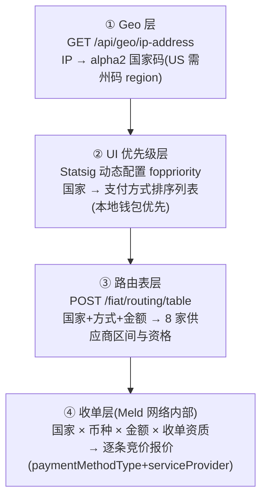

# Fun (fun.xyz) 国家适配与支付方式路由机制

> 调研日期:2026-11-02
> 起因:一次对 `frog.fun.xyz/api/meld/quote` 的实测(HK $500 → VISA via MoonPay)引出的问题:"怎么根据国家来适配支持的卡"。
> 依据:`@funkit/api-base@10.0.0` 源码(meld/types.ts)、Fun 客户线上 bundle 的 Statsig 动态配置(`foppriority`)、frog 网关实测(HK/US/BR/DE/NG 四组报价对比)。
> 姊妹篇:《fun-功能与接口完整文档》(§5.6 供应商子域)、《fun-出入金业务流程与接入架构》(§3.2 供应商路由)。

---

## 1. 结论先行

**"按国家适配卡"不是单点判断,而是四层协作**;你在请求里传的 `countryCode` 只是"入场券":

1. **Geo 层**先确定用户在哪(IP → 国家码,美国还要州码)
2. **UI 优先级层**按国家决定**给用户看什么**(本地钱包优先矩阵:巴西 PIX、菲律宾 GCash……)
3. **路由表层**按"国家 × 方式 × 金额区间"决定**哪家供应商接单**(Fun 的 8 家)
4. **收单层**(Meld 内部)决定**哪张卡组织/收单方实际承兑并报价**

同一个 $500 买 USDC:美国能拿到 Stripe 的 $10.32 报价(与 MoonPay $20.59 竞价),香港只有 MoonPay 一条路——差异全部来自这四层。

---

## 2. 四层架构



### 2.1 Geo 层

- `GET frog.fun.xyz/api/geo/ip-address` → `FiatGeo { alpha2, region?, ip? }`
- 美国买家**必须**传 `region`(US 州码),空 region 视为缺省(路由契约的硬规则)
- 前端据此填入后续所有请求的 `country` / `region` 字段

### 2.2 UI 优先级层:`foppriority` 国家矩阵(核心)

配置形态:Statsig 动态配置(宿主线上 bundle 实测提取),`variants` 按**国家条件**返回支付方式有序列表——排序即 UI 展示顺序。完整矩阵:

| 适用国家 | 支付方式优先级(截取前几项) |
|---|---|
| 🇺🇸 美国 + 欧美主流 32 国<br/>(AD AE AM AT AU AW AZ CH CZ DE DK DM GA GB GG GL GP HU IE IT JE KN KW LU ME NL OM PG PL QA SA SE TW **US** UZ ZA) | **APPLE_PAY → NATIVE_CASH_APP_LIGHTNING → CARDS** → GOOGLE_PAY → REVOLUT_PAY → PAYPAL → BANK_TRANSFER → PIX → SKRILL |
| 🇦🇷 AR / 🇬🇭 GH / 🇰🇪 KE | **ASTROPAY** → CARDS → APPLE_PAY → … |
| 🇱🇰 LK / 🇲🇴 MO / 🇸🇷 SR / 🇹🇲 TM / 🇻🇺 VU / 🇮🇳 IN | **GOOGLE_PAY** → CARDS → … |
| 🇧🇷 BR | **PIX** → CARDS → APPLE_PAY → … |
| 🇨🇦 CA | **INTERAC** → CARDS → … |
| 🇮🇩 ID | **GOPAY** → CARDS → … |
| 🇲🇾 MY | **TOUCHNGO** → CARDS → … |
| 🇳🇴 NO | **VIPPS** → CARDS → … |
| 🇵🇭 PH | **GCASH** → CARDS → … |
| 🇹🇭 TH | **PROMPTPAY** → CARDS → … |
| 🇻🇳 VN | **VIETQR** → CARDS → … |

设计思路:**本地钱包优先,卡(CARDS)反而靠后**——巴西人先看到 PIX,菲律宾先看到 GCash;没有强势本地钱包的国家(如 HK)落入通用组,才是卡优先。

### 2.3 路由表层

`POST /fiat/routing/table`(请求字段:`cryptoCurrencyCode`、`chainId`、`country`、`region?`、`methods[]`、`fiatCurrencyCode?`、`destinationAsset?`、`providers?`):

- 返回每个支付方式下,**各供应商可服务的金额区间**(min/max,可有多段)
- 表是 **advisory**:每次路由询价会重新校验供应商资格;`expiresAt` 到期、`refreshLimits:true`、认证/KYC 之后都要重取
- 落到无路可走时返回 `BlockedReason: ALL_PROVIDERS_DECLINED / AMOUNT_UNSERVABLE / REGION_UNSUPPORTED …`

### 2.4 收单层:Meld 聚合网络

`/api/meld/*` 是 Frog 对 **Meld**(聚合收单)的透传。Meld 内部网络(源码枚举实证)包含 30+ 服务商:

**卡组织/方式:** VISA、MASTERCARD、APPLE_PAY、PAYPAL、REVOLUT、SEPA、SKRILLCRYPTO
**收单/服务商:** MOONPAY、STRIPE、SIMPLEX、MERCURYO、TRANSAK、BANXA、SARDINE、ALCHEMYPAY、GUARDARIAN、BTCDIRECT、BINANCECONNECT、BLOCKCHAINDOTCOM、COINBASEPAY、MESH、MESO、ONMETA、ONRAMPMONEY、PAYBIS、RAMP、TOPPER、TRANSFI、UNLIMIT、KRYPTONIM、BILIRA、FONBNK、KOYWE、YELLOWCARD、SWAPPED …

Meld 按"国家 × 币种 × 金额 × 各家在该国的收单资质"筛选,返回逐条报价供前端择优。

---

## 3. Meld 报价接口字段(实测文档化)

### 3.1 请求:`POST frog.fun.xyz/api/meld/quote`(头:`X-Api-Key`)

```jsonc
{
  "countryCode": "HK",                    // ISO 3166-1 alpha-2,透传给 Meld 做国家筛选
  "destinationCurrencyCode": "USDC_POLYGON", // Meld 风格资产标识("币种_链")
  "sourceAmount": "500",                  // 法币金额(字符串)
  "sourceCurrencyCode": "USD",
  "externalCustomerId": "0xa3d1…",        // 宿主侧用户标识(钱包地址),用于风控/追踪
  "paymentMethodType": "VISA",            // 可选:过滤卡种(VISA/MASTERCARD/APPLE_PAY…)
  "serviceProviders": ["MOONPAY"],        // 可选:过滤服务商
  "customerId": "…"                       // 可选:Meld 侧客户 ID
}
```

### 3.2 响应(逐条报价数组)

| 字段 | 实测值(HK) | 说明 |
|---|---|---|
| `paymentMethodType` | `VISA` | 承兑卡种/方式 |
| `serviceProvider` | `MOONPAY` | 实际收单服务商 |
| `destinationAmount` | `471.46` | 到账数量 |
| `exchangeRate` | `1.0169` | 汇率 |
| `totalFee` | `20.59` | 总费 |
| `transactionFee` / `networkFee` / `partnerFee` | `19.18 / 0.21 / 1.20` | 费用拆解(交易费/网络费/合作方抽成) |
| `fiatAmountWithoutFees` | `479.41` | 去费法币额 |
| `customerScore` | `30` | Meld 对该用户**转化概率评分**(用于排序) |
| `transactionType` | `CRYPTO_PURCHASE` | 交易类型 |

### 3.3 实测:同一请求只改国家(2026-11-02)

| 国家 | 返回条数 | 报价 |
|---|---|---|
| **HK** | 1 | VISA via MoonPay,费 $20.59,到账 471.46 |
| **US** | 2 | VISA/MoonPay $20.59 vs **VISA/Stripe $10.32(到账 489.69)** ← 竞价择优 |
| BR / DE / NG | 1 | 各只有 MoonPay |

附:HK 传 `paymentMethodType: MASTERCARD` 或 `APPLE_PAY` 过滤,仍返回 VISA via MoonPay——说明该地区该金额可用通道就这一条,**过滤参数是建议性的,不构成硬约束**。

---

## 4. 端到端示例:一个 HK 用户的完整适配路径

```
用户(香港 IP)打开收银台
① geo 层:IP → countryCode=HK(无 region)
② foppriority:HK 未命中专属本地钱包 → 通用组,UI 顺序 = CARDS/APPLE_PAY/GOOGLE_PAY/…
③ 用户选"卡",输入 $500 买 USDC(Polygon)
   → routing/table:HK + CARDS + $500 → 可行供应商
   → meld/quote:countryCode=HK 透传 → Meld 返回 1 条 VISA via MoonPay($20.59)
④ 前端展示唯一报价 → 用户确认 → 进入 /fiat/* 状态机(KYC→ORDER→PAYMENT→DELIVERY)
```

对比:同样的美国用户在第 ③ 步会拿到两条报价,前端展示/自动择优 Stripe($10.32)。

---

## 5. 对接入方的启示

1. **国家适配不需要你做**:前端直连场景,SDK 会自动 geo → 矩阵 → 路由 → 报价;你只需要把 `countryCode` 传对(或依赖 IP 自动判定)
2. **报价要多家比**:同国家同金额可能多条报价(US 实测价差 2 倍),`serviceProviders` 过滤用于"只用某家"的战略绑定,否则默认择优
3. **本地支付决定转化率**:如果你的用户集中在某个市场(如东南亚),检查 foppriority 矩阵里该国的第一优先方式是否真的可用(GOPAY/TOUCHNGO/GCASH 等依赖 Fun 供应商侧的实际开通),不可用时会落到卡
4. **金额也影响可用性**:路由表按金额区间给供应商,小额定卡通道、大额可能只剩银行转账——建议入金页在用户输完金额后重新询价
5. `customerScore` 是 Meld 的转化预测分,只用于排序,不是风控拒绝

## 附:相关文档索引

| 文档 | 相关章节 |
|---|---|
| 《fun-功能与接口完整文档》 | §5.1 路由表端点、§5.6 供应商子域、§7.4 供应商与支付方式枚举 |
| 《fun-出入金业务流程与接入架构》 | §3.2 供应商路由与询价 |
| 源码 | `api-base/src/services/meld/types.ts`(请求/响应全字段)、`fiat-contract/dist/routing.d.ts`(路由契约)、宿主线上 bundle 的 `foppriority` Statsig 配置 |
